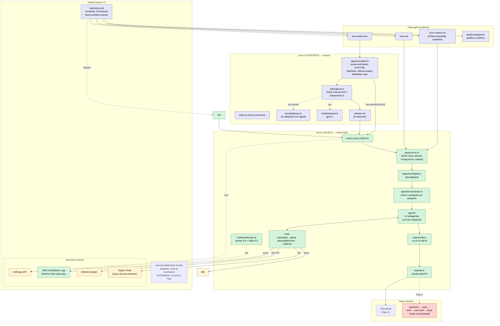
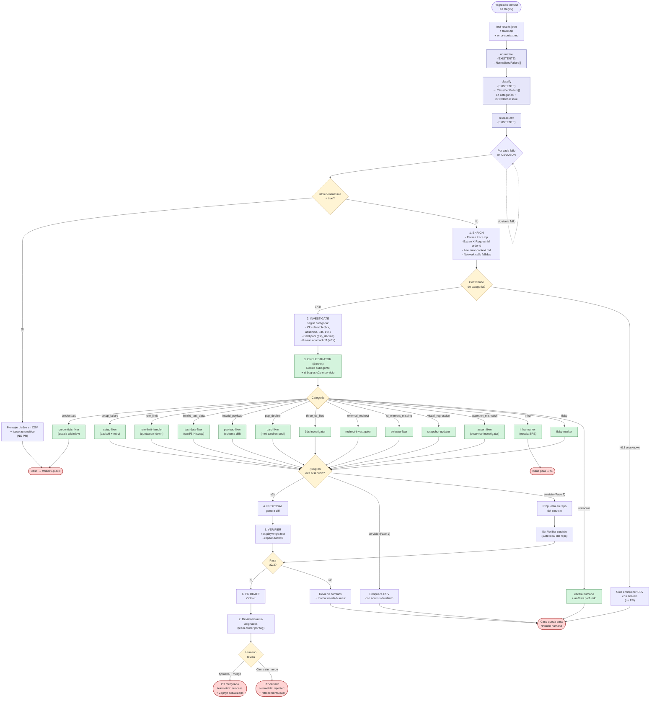
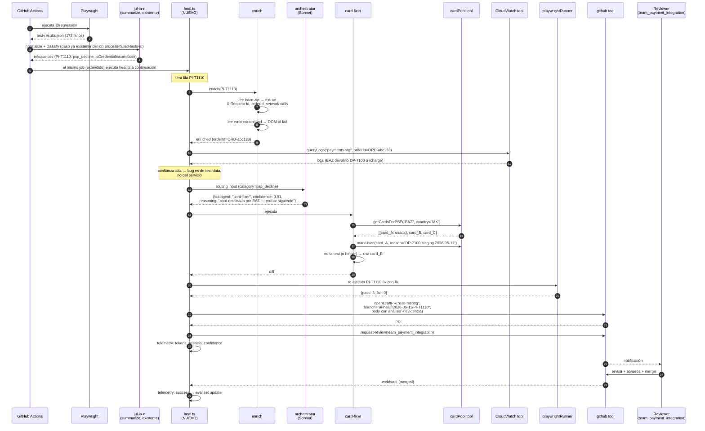
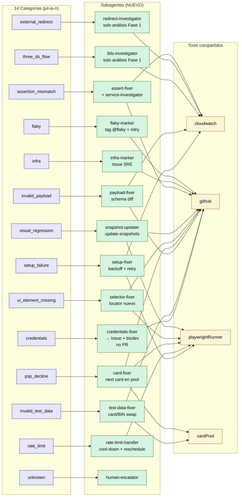
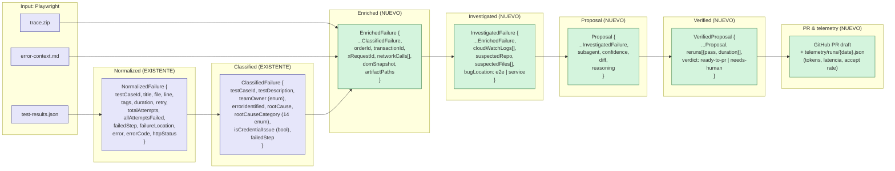
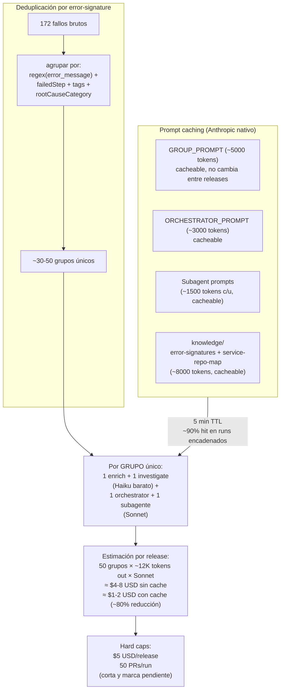

# AI Agent para auto-triage y auto-fix de regresiones E2E

> Plan de implementación — DEUNA E2E testing. Diagramas en Mermaid (renderizan en GitHub, GitLab, Notion, Obsidian, VSCode con extensión). Editor online: https://mermaid.live.

## Context

DEUNA ejecuta regresiones de Playwright sobre staging **dos veces por semana** y obtiene típicamente entre **15 y 200 tests fallidos** por release. Hoy `jul-ia-n/` ya hace **clasificación robusta** de cada fallo:

- `steps/normalize.ts` parsea `test-results.json` y extrae por fallo: `testCaseId` (regex `@PREFIX-T\d+`), `title` limpio, `tags`, `retry`/`totalAttempts`, `failedStep` (paseando el árbol de steps en reversa), `failureLocation` (`test` / `beforeAll` / `beforeEach` con detección de hooks), `error` (sin ANSI), **`errorCode`** (regex DP-XXXX), **`httpStatus`** (regex de status code).
- `steps/group.ts` llama OpenAI `gpt-5.2` con **JSON schema strict** (`response_format: json_schema`, `temperature: 0`), produce `ClassifiedFailure[]` validado con 8 campos incluyendo `rootCauseCategory` (uno de 14 valores) y `isCredentialIssue` (boolean separado del category — habilita auto-trigger del mensaje bizdev sin colisionar con `psp_decline`).
- `prompts/group.ts` tiene catálogo de **14 categorías** ordenadas (first-match-wins): `credentials` · `setup_failure` · `rate_limit` · `invalid_test_data` · `invalid_payload` · `psp_decline` · `three_ds_flow` · `external_redirect` · `ui_element_missing` · `visual_regression` · `assertion_mismatch` · `infra` · `flaky` · `unknown`. Cada una con signals concretos (regex, frases, status codes).
- Output: `release.csv` con 8 columnas: `Test Case Id`, `Test Description`, `Team Owner`, `Error Identified`, `Root Cause`, `Root Cause Category`, `AI Proposed Solution`, `Failed Step`.

**Problema:** los devs todavía revisan **uno por uno** los fallidos. La clasificación ayuda a agrupar/asignar, pero no resuelve nada. **Objetivo:** sobre esta base ya sólida, construir un **agente que abra PR draft** con la solución propuesta — ya sea en `e2e-testing` (Fase 1) o en el repo del servicio responsable: `payments`, `vault`, `ema`, etc. (Fase 2). Humanos siempre revisan antes de mergear.

**Decisiones tomadas con el usuario:**

- **Scope:** híbrido por fases (Fase 1: solo `e2e-testing`; Fase 2: agregar repos de servicios, empezando por `payments`).
- **Trigger:** auto-triage post-regresión vía extensión del job `process-failed-tests-ai` que ya existe en el workflow externo `DUNA-E-Commmerce/github-actions/regression_tests.yml`. Para deep-fix puntual, ejecución local (`npm run ai-heal -- --testcase X`) — no se expone trigger manual desde GitHub UI por ahora.
- **Autonomía:** **PR-only, siempre revisado por humano**. Nunca auto-merge.
- **Logs:** **CloudWatch** (nuevo) — coordinar con DevOps IAM read-only por servicio.
- **LLM:** migrar de OpenAI a **Anthropic Claude** (Sonnet 4.6 para razonamiento/codegen, Haiku 4.5 para clasificación). Aprovechar **prompt caching nativo**.
- **Card bank:** híbrido — reusar pools en `playwright/support/interfaces/debit_cards/`; si se agota, escalar con propuesta.
- **Arquitectura:** **orchestrator + subagentes especializados** mapeados 1:1 con las 14 categorías.
- **Escala:** 15-200 fallidos × 2 releases/semana ≈ 30-1600 casos/mes. Diseño defensivo en costo (prompt caching + dedup por error-signature).

---

## Diagramas

### Diagrama 1 — Arquitectura de componentes (alto nivel)

Bloques principales del sistema y qué es nuevo vs reusado. **Importante:** la pipeline `summarize` (existente) sigue intacta. La capa nueva (`heal`) consume el `ClassifiedFailure[]` como input — no re-clasifica.



---

### Diagrama 2 — Pipeline end-to-end (flowchart)

Cómo fluye un test fallido desde la regresión hasta el merge. **El modo `summarize` no cambia** — solo se agrega la rama `heal` que parte del output del clasificador existente.



---

### Diagrama 3 — Secuencia: `PI-T1110` (BAZ decline)

Caso real del `release.csv` actual: PSP BAZ devuelve `DP-7100` (422). Flujo completo desde el fail hasta el merge.



---

### Diagrama 4 — Mapeo categoría → subagente → tools

Mapa exhaustivo de las 14 categorías a sus subagentes especializados.



---

### Diagrama 5 — Datos que se mueven por el pipeline

Cómo crece el contexto de cada fallo. **`NormalizedFailure` ya es rica** — el enrichment agrega solo lo que falta.



---

### Diagrama 6 — Scope Fase 1 vs Fase 2

```mermaid
flowchart LR
    subgraph PH1["Fase 1 (3-4 semanas) — solo e2e-testing"]
        direction TB
        P1A["✅ Migración OpenAI → Claude<br/>(preserva JSON schema strict<br/>+ 14 categorías + isCredentialIssue)"]
        P1B["✅ Enrichment layer<br/>(trace.zip parser + error-context reader)"]
        P1C["✅ Investigation layer<br/>(CloudWatch wrapper)"]
        P1D["✅ Orchestrator + 14 subagentes<br/>(mapeo 1:1 con categorías)"]
        P1E["✅ Tools: cardPool, playwrightRunner,<br/>github (DUNA_ACTION_TOKEN), cloudwatch"]
        P1F["✅ Verifier (re-run 3x)"]
        P1G["✅ PR draft solo en e2e-testing"]
        P1H["✅ 3ds-investigator, redirect-investigator,<br/>service-investigator → read-only<br/>(enriquecen CSV, no abren PR)"]
        P1I["✅ Telemetría + eval set golden (20-30 casos)"]
        P1J["⏳ Extender job process-failed-tests-ai<br/>en DUNA-E-Commmerce/github-actions<br/>(no es trabajo en este repo;<br/>requiere PR cross-repo)"]
    end

    subgraph PH2["Fase 2 (4-6 semanas tras validar)"]
        direction TB
        P2A["✅ GitHub App<br/>(reemplaza DUNA_ACTION_TOKEN)<br/>permisos cross-repo allowlisted"]
        P2B["✅ knowledge/service-repo-map.json<br/>(prefijo testcase + tag → repo,<br/>log group, owners)"]
        P2C["✅ service-investigator promovido<br/>(clona repo, aplica patch, abre PR)"]
        P2D["✅ Empezar por payments<br/>(mayoría de fallos según release.csv)"]
        P2E["⏳ Luego: vault, ema, user-auth, fraud<br/>(uno por uno con métricas por repo)"]
        P2F["⏳ runServiceTests por repo<br/>(si tienen suite local liviana)"]
    end

    GATE{Métricas Fase 1<br/>(≥3 releases medidos):<br/>≥30% PRs aceptados<br/>≤5% wrong-fix<br/>< $5/release tokens}

    PH1 --> GATE
    GATE -- "✓ pasa" --> PH2
    GATE -- "✗ no pasa" --> ITER["Iterar prompts<br/>+ eval set<br/>+ ajustar confidence thresholds"]
    ITER --> GATE

    classDef done fill:#d4f4dd,stroke:#2d7a3e
    classDef pending fill:#fff4d4,stroke:#a07020
    classDef gate fill:#ffd4d4,stroke:#a02020
    class P1A,P1B,P1C,P1D,P1E,P1F,P1G,P1H,P1I,P1J done
    class P2A,P2B,P2C,P2D,P2E,P2F pending
    class GATE,ITER gate
```

---

### Diagrama 7 — Modelo de costo y caching



---

## Arquitectura propuesta — detalle por capa

Renombramos nada. **`jul-ia-n/` queda intacto en sus rutas actuales**; agregamos archivos nuevos junto a los existentes. Mantenemos `npm run ai-summarize` (no cambia) y agregamos `npm run ai-heal`.

### Estructura final

```
jul-ia-n/
├── index.ts                       # entry summarize (EXISTENTE — no se toca)
├── heal.ts                        # entry heal (NUEVO)
├── models/
│   ├── openai.ts                  # EXISTENTE (mantener hasta finalizar migración)
│   └── anthropic.ts               # NUEVO — Sonnet + Haiku con prompt caching helpers
├── steps/
│   ├── index.ts                   # EXISTENTE (extender exports)
│   ├── normalize.ts               # EXISTENTE — no se toca
│   ├── group.ts                   # EXISTENTE — migrar internamente a Anthropic
│   ├── enrich.ts                  # NUEVO — parsea trace.zip + error-context.md
│   └── investigate.ts             # NUEVO — wrapper CloudWatch
├── agents/                        # NUEVO
│   ├── orchestrator.ts            # router categoría → subagente
│   ├── credentialsFixer.ts        # 1
│   ├── setupFixer.ts              # 2
│   ├── rateLimitHandler.ts        # 3
│   ├── testDataFixer.ts           # 4
│   ├── payloadFixer.ts            # 5
│   ├── cardFixer.ts               # 6
│   ├── threeDsInvestigator.ts     # 7 (read-only Fase 1)
│   ├── redirectInvestigator.ts    # 8 (read-only Fase 1)
│   ├── selectorFixer.ts           # 9
│   ├── snapshotUpdater.ts         # 10
│   ├── assertFixer.ts             # 11
│   ├── infraMarker.ts             # 12
│   ├── flakyMarker.ts             # 13
│   ├── humanEscalator.ts          # 14
│   └── serviceInvestigator.ts     # cross-cutting (read-only Fase 1)
├── tools/                         # NUEVO
│   ├── cloudwatch.ts              # @aws-sdk/client-cloudwatch-logs
│   ├── github.ts                  # @octokit/rest
│   ├── playwrightRunner.ts        # ejecuta npx playwright test --repeat-each
│   ├── cardPool.ts                # lee debit_cards/, marca usadas, retorna fallback
├── prompts/
│   ├── group.ts                   # EXISTENTE — no se toca
│   ├── orchestrator.ts            # NUEVO (cacheable)
│   └── subagents/                 # NUEVO — 14 prompts (cacheables)
│       ├── credentialsFixer.ts
│       ├── setupFixer.ts
│       ├── rateLimitHandler.ts
│       ├── testDataFixer.ts
│       ├── payloadFixer.ts
│       ├── cardFixer.ts
│       ├── threeDsInvestigator.ts
│       ├── redirectInvestigator.ts
│       ├── selectorFixer.ts
│       ├── snapshotUpdater.ts
│       ├── assertFixer.ts
│       ├── infraMarker.ts
│       ├── flakyMarker.ts
│       └── humanEscalator.ts
├── knowledge/
│   ├── database/                  # EXISTENTE (vacío)
│   ├── service-repo-map.json      # NUEVO (Fase 2)
│   ├── psp-card-fallbacks.json    # NUEVO (cards extras)
│   └── error-signatures.json      # NUEVO (dedup regex)
├── schemas/                       # NUEVO — zod schemas compartidos
│   ├── classifiedFailure.ts
│   ├── enrichedFailure.ts
│   ├── investigatedFailure.ts
│   ├── proposal.ts
│   └── verifiedProposal.ts
├── eval/                          # NUEVO
│   ├── golden-cases.json
│   └── README.md
├── telemetry/                     # NUEVO (gitignored)
│   └── runs/{YYYY-MM-DD}.json
├── release.csv                    # EXISTENTE
└── README.md                      # EXISTENTE — actualizar con modo heal
```

---

## Plan de implementación

### Fase 1 — `e2e-testing` only (3-4 semanas)

**Objetivo:** que el agente cierre por sí solo los casos cuya solución vive en este repo (card swap, selector roto, assert obvio post-validación logs, marcar flakies, fix de timeout). Para casos donde el bug está en servicio, **solo enriquece el CSV** sin abrir PR cross-repo.

#### 1.1 Migración OpenAI → Anthropic (preservando el contrato actual)

- Crear `jul-ia-n/models/anthropic.ts`. **Invocar el skill `claude-api`** durante implementación para asegurar prompt caching correcto, modelo actualizado y manejo de errores idiomático del SDK.
- Migrar `steps/group.ts` para llamar a Claude usando **tool use con `input_schema`** estricto (equivalente Anthropic de `response_format: json_schema`). Mantener:
  - Mismo `failureAnalysisSchema` (zod o JSON schema equivalente).
  - Misma enum de 14 `ROOT_CAUSE_CATEGORIES`.
  - Misma enum de 7 `TEAM_OWNERS`.
  - Mismo `isCredentialIssue` boolean.
  - Misma `temperature: 0`.
- Usar **Haiku 4.5** para clasificación (es trabajo barato, deterministic, estructurado). Sonnet 4.6 solo para razonamiento del orchestrator y subagentes que generan código.
- Activar **prompt caching** en `GROUP_PROMPT` (es estable entre releases). Cache breakpoint al final del system prompt.
- Mantener `OPENAI_MODEL` env override por compatibilidad temporal; agregar `ANTHROPIC_MODEL` con default `claude-haiku-4-5-20251001`.
- Agregar `ANTHROPIC_API_KEY` a `.env.example` y workflows.
- **Validación de paridad:** crear `jul-ia-n/eval/parity-test.ts` que ejecuta ambos clasificadores sobre el mismo `test-results.json` y compara `ClassifiedFailure[]`. Aceptar migración si **diferencia ≤5%** (algunos `errorIdentified` redactados distinto, pero categorías y `isCredentialIssue` deben coincidir ≥95%).

#### 1.2 Enrichment layer

`steps/enrich.ts`: por cada `ClassifiedFailure`, busca artefactos:

- **trace.zip** — Playwright los guarda en `playwright/test-results/{slug}/trace.zip`. Es un ZIP con `*.trace`, `*.network`. Parseo:
  - Usar `adm-zip` o `yauzl` para extraer.
  - El archivo `.network` es JSONL con cada request — extraer `X-Request-Id` headers, URLs, status codes, response bodies.
  - El archivo `.trace` tiene eventos de UI — extraer screenshots con timestamps si están embebidos.
- **error-context.md** — `playwright/test-results/{slug}/error-context.md` — DOM accessibility snapshot. Leer texto plano.
- **Extracción de IDs:**
  - `orderId` — patrones `ord[_-]?[a-z0-9-]{8,}`, también respuestas JSON con `"orderToken"`, `"orderId"`.
  - `transactionId` — patrón equivalente.
  - `X-Request-Id` — headers de las requests fallidas.

Output: `EnrichedFailure` (schema en `schemas/enrichedFailure.ts`).

#### 1.3 Investigation layer (tools del agente)

`tools/cloudwatch.ts` — usa `@aws-sdk/client-cloudwatch-logs`:

```typescript
async function queryLogs(opts: {
  logGroup: string;      // ej. "/aws/ecs/payments-stg"
  filterPattern: string; // CloudWatch Insights / FilterPattern syntax
  startTime: number;     // unix ms (test start - 30s)
  endTime: number;       // unix ms (test end + 30s)
  limit?: number;        // default 200
}): Promise<LogEvent[]>
```

- Credenciales: `AWS_REGION`, `AWS_ACCESS_KEY_ID`, `AWS_SECRET_ACCESS_KEY` en `.env`. **Bloqueante:** coordinar con DevOps un IAM user con permiso `logs:FilterLogEvents` sobre los log groups objetivo (sugerencia inicial: `payments-stg`, `vault-stg`, `ema-stg`, `user-auth-stg`, `fraud-stg`).
- Exponer al LLM como tool con descripción clara: "Fetches application logs from CloudWatch by orderId or X-Request-Id within the test's time window."

_Sin tool dedicada de Metabase._ Las queries de Metabase de `playwright/support/request_helper/requestUtil.ts` están diseñadas para que tests validen estado en BD; replicarían info que ya está en el `raw_response` del request fallido capturado en `trace.zip` (el `error` y `raw_response` que devuelve `/purchase` ya viajan en el assert de Playwright y los extrae el enrich step). CloudWatch cubre los logs aplicativos del lado servicio. Eliminar la dependencia de Metabase reduce creds en CI (`MB_USER`/`MB_PASSWORD`), latencia y carga sobre Metabase prod.

`tools/github.ts` — Octokit:

- `openDraftPR({ repo, branch, title, body, files })`
- `commentPR({ repo, prNumber, body })`
- `requestReview({ repo, prNumber, teams })`
- Token: `DUNA_ACTION_TOKEN` (existente). Fase 2 migra a GitHub App.

`tools/playwrightRunner.ts`:

- `runTest({ specPath, repeat=3, project='chromium', timeout=240000 })` ejecuta `npx playwright test {file} --repeat-each={n} --reporter=json --project={p}` con CWD = repo root.
- Devuelve `{ passed: number, failed: number, durations: number[], errors: string[] }`.
- **Importante:** ejecuta en un branch git temporal aislado (`git worktree add` o checkout en `/tmp`) para no contaminar el workspace.

`tools/cardPool.ts`:

- Lee dinámicamente `playwright/support/interfaces/debit_cards/*.ts` exportados (uso `ts-morph` o import dinámico).
- API: `getCardsForPSP(pspName, country)` → `Card[]` con metadata `{used: boolean, lastDeclineDate?: string, lastDeclineCode?: string}`.
- Persistencia del estado "usada en staging" en `knowledge/psp-card-fallbacks.json` (gitignored al inicio; promovible a commited cuando se valide).

_Sin tool dedicada de Zephyr._ Para construir links a Jira/Zephyr en el body del PR/Issue, `steps/pr.ts` tiene un helper inline `buildTestCaseUrl(testCaseKey)` (3 líneas) que arma `https://${JIRA_DOMAIN}/browse/{key}`. La integración con Zephyr para publicar resultados de ejecución sigue siendo responsabilidad de `playwright/support/zephyr/services/testCycleService.ts` (existente, fuera del scope de jul-ia-n).
- Permite linkear el PR generado al test case en Zephyr y opcionalmente comentar análisis.

#### 1.4 Orchestrator + 14 subagentes

`agents/orchestrator.ts`:

- **Modelo:** Claude Sonnet 4.6 (razonamiento).
- **Input:** `InvestigatedFailure`.
- **Output schema (tool use):**
  ```ts
  {
    subagent: SubagentName,
    bugLocation: 'e2e' | 'service',
    suspectedRepo: string | null,  // null para Fase 1 si servicio
    confidence: number,             // 0-1
    reasoning: string,
  }
  ```
- **Prompt** (`prompts/orchestrator.ts`): explica las 14 categorías, los signals adicionales que dan confianza, cuándo derivar a `service-investigator`, cuándo `human-escalator`. **Cacheable.**

Cada subagente es una función `async run(input, tools) → Proposal`:

| # | Subagente | Acción | Output |
|---|---|---|---|
| 1 | `credentialsFixer` | No genera diff. Abre **Issue** taggeado para #bizdev-public. | Issue link |
| 2 | `setupFixer` | Re-ejecuta 2x con backoff. Si persiste, propone `test.retry(1)` en `beforeAll` o marca caso para humano. | Diff o Issue |
| 3 | `rateLimitHandler` | Marca caso con `@rate-limited`, propone re-scheduling en horario distinto. No edita test data. | Issue + tag |
| 4 | `testDataFixer` | Para BIN/card inválidos: usa `cardPool` para encontrar válida. | Diff |
| 5 | `payloadFixer` | Lee CloudWatch para ver request real vs expected. Propone fix en helper de construcción del payload. | Diff (con baja confianza → siempre draft) |
| 6 | `cardFixer` | Próxima card del pool. Si pool agotado → escalar humano con propuesta de buscar en docs PSP. | Diff |
| 7 | `threeDsInvestigator` | **Read-only Fase 1.** Lee CloudWatch + network calls del trace, enriquece CSV con análisis del flujo 3DS. | Enrichment, no diff |
| 8 | `redirectInvestigator` | **Read-only Fase 1.** Similar a 3ds. | Enrichment, no diff |
| 9 | `selectorFixer` | Lee `error-context.md`, propone nuevo locator (`getByRole` > `getByText` > `getByTestId` > CSS). Solo si el elemento aparece en el DOM con accessibility distinto. | Diff |
| 10 | `snapshotUpdater` | Solo para tests bajo proyecto `visual-testing`. Ejecuta `--update-snapshots` en branch aislado, commitea diff de `.png`. **Confidence siempre cap a 0.5** — visual diffs son sensibles. | Diff + screenshot before/after |
| 11 | `assertFixer` | Verifica con CloudWatch si servicio cambió legítimamente. Si sí, ajusta expected. Si no, deriva a `serviceInvestigator`. | Diff o derivación |
| 12 | `infraMarker` | Issue automático con tag `@infra` + ping a SRE team. No edita test. | Issue link |
| 13 | `flakyMarker` | Si `totalAttempts > 1 && !allAttemptsFailed`: agrega tag `@flaky` y configura retry en el test. | Diff |
| 14 | `humanEscalator` | Para `unknown` o casos donde subagentes no aplican: análisis profundo + asignación a team owner. | Enrichment con sugerencias |
| ✱ | `serviceInvestigator` | Cross-cutting. Llamado por 5/7/8/11 cuando bug parece de servicio. **Read-only en Fase 1**. | Enrichment con suspectedRepo + suspectedFiles |

#### 1.5 Verifier

`steps/verify.ts`:

- Crea worktree en `/tmp/ai-heal-{releaseId}-{tcId}/`.
- Aplica el diff propuesto al worktree.
- Ejecuta `tools/playwrightRunner.runTest({ specPath, repeat: 3 })`.
- Si `passed ≥ 2`, marca `verdict: 'ready-to-pr'`. Si no, `verdict: 'needs-human'` y revierte.
- **Subagentes sin diff (1, 3, 12, 14, 7, 8):** saltan verifier, van directo a PR/Issue.

#### 1.6 PR creator

`steps/pr.ts`:

- Branch: `ai-heal/{releaseId}/{testCaseId}` desde `develop`.
- Commit message: `fix(ai-heal): {testCaseId} {short summary}`.
- PR draft con body template (Spanish since DEUNA es LatAm-first):

```markdown
## Test fallido
- **Test case:** [`{testCaseId}`]({testCaseLink})
- **Team:** `{teamOwner}`
- **Categoría:** `{rootCauseCategory}`
- **Subagente:** `{subagent}` (confidence: `{confidence}`)

## Análisis IA
{reasoning del orchestrator + subagente}

## Evidencia
- Trace: {link al artifact}
- CloudWatch logs: {link}
- DOM snapshot: {link al error-context.md}

## Cambio propuesto
{summary del diff + archivos}

## Verificación
Re-ejecutado **{passed}/{total}** veces en local.
Confidence final: `{verifiedConfidence}`

---
⚠️ **PR generado por jul-IA-N (auto-heal).** Revisión humana obligatoria. Si la solución no es correcta, cerrá el PR sin merge para que el agente aprenda (telemetría).
```

- Auto-asigna reviewers según team tag (mapping en `knowledge/team-reviewers.json`, NUEVO).
- Label `ai-heal` + label por categoría (ej. `ai-heal/psp_decline`).
- En descripción del PR, incluir un check para el reviewer:
  ```
  - [ ] La solución propuesta es correcta
  - [ ] La evidencia respalda el análisis
  - [ ] El test re-ejecutado pasa de forma consistente
  ```

#### 1.7 Integración con CI (extensión del workflow externo)

**No se crea workflow nuevo en este repo.** La regresión ya corre vía `regression.yml` → workflow reusable en `DUNA-E-Commmerce/github-actions/regression_tests.yml`, que tiene un job `process-failed-tests-ai` que actualmente ejecuta `npm run jul-ia-n` (modo summarize) y sube `jul-ia-n/release.csv` como artifact.

La integración se hace **extendiendo ese job** (PR cross-repo al repo `github-actions`):

- **Reemplazar el comando** `npm run jul-ia-n playwright-report/retry-failed-tests.json` por `npm run ai-heal -- --input playwright-report/retry-failed-tests.json --release-id $RELEASE_ID`. El nuevo comando ejecuta el pipeline completo (classify + enrich + investigate + orchestrator + subagentes + verify + PR) y reescribe `release.csv` con la columna 7 expandida.
- **Agregar env vars al job:** `AI_PROVIDER`, `ANTHROPIC_API_KEY`, `AWS_REGION`, `AWS_ACCESS_KEY_ID`, `AWS_SECRET_ACCESS_KEY`, `AI_HEAL_LOG_GROUPS`, `AI_HEAL_BASE_BRANCH`, `AI_HEAL_BUDGET_USD`, `AI_HEAL_PR_CAP`, `GITHUB_TOKEN`.
- **Permisos del workflow:** agregar `pull-requests: write` e `issues: write` (hoy seguramente solo tiene `contents: read`).
- **Step adicional:** `npx playwright install chromium --with-deps` antes del `Run AI processing` — necesario para que el verifier (re-run 3x) tenga el browser.
- **Artifact extendido:** subir también `jul-ia-n/telemetry/runs/` con `retention-days: 30` para auditoría histórica.
- **Hard caps por env:** `AI_HEAL_BUDGET_USD=5` y `AI_HEAL_PR_CAP=50` siguen aplicando — confidence threshold también (default 0.80 vía `--confidence-threshold`).

**Mientras tanto** (Fase 1, validación local): cualquier dev/QA ejecuta el pipeline localmente:
```bash
npm run ai-heal -- --input playwright-report/test-results.json --testcase PI-T1110 --no-pr
```
Para esto necesita las env vars en su `.env` local (`ANTHROPIC_API_KEY` mínimo). No hay trigger manual desde GitHub UI.

#### 1.8 Telemetría y guardrails

- `telemetry/runs/{YYYY-MM-DD}-{releaseId}.json` con:
  - Tokens (input/output/cached) por etapa y subagente.
  - Latencia por etapa.
  - Hit rate de cache.
  - Subagente invocado por caso.
  - Confidence inicial vs final.
  - PR abierto sí/no, mergeado sí/no (via GitHub webhook).
- **Hard limits:**
  - $5 USD/release en tokens (cortar si se excede, marcar pendientes).
  - 50 PRs abiertos por run (evitar spam si pipeline se rompe).
  - **Allowlist de archivos editables:** solo bajo `playwright/tests/` y `playwright/support/interfaces/`. **Nunca** tocar `playwright.config.ts`, `playwright/support/fixtures/`, `playwright/support/http/`, `jul-ia-n/`, `.github/`.

#### 1.9 Eval set

`eval/golden-cases.json` con **20-30 casos pasados** etiquetados por humano (root cause real, fix correcto). Estructura:

```json
{
  "cases": [
    {
      "testCaseId": "PI-T1110",
      "input": { "...": "NormalizedFailure" },
      "expectedClassification": { "rootCauseCategory": "psp_decline", "isCredentialIssue": false },
      "expectedSubagent": "cardFixer",
      "expectedFixType": "card-swap",
      "actualFixCommit": "abc123def"
    }
  ]
}
```

Ejecutar `npm run ai-heal -- --eval` antes de cada PR a `jul-ia-n/` para detectar regresiones en clasificación o routing.

---

### Fase 2 — Multi-repo, empezando por `payments` (4-6 semanas tras validar Fase 1)

Solo después de **3 releases medidos** con métricas: ≥30% PRs aceptados, ≤5% wrong-fix.

#### 2.1 GitHub App

- Reemplazar `DUNA_ACTION_TOKEN` por GitHub App org-wide instalada en `DUNA-E-Commmerce`.
- Permisos: `contents: write`, `pull_requests: write` solo en repos allowlisted.
- Token runtime con install_id, no static.

#### 2.2 Service repo mapping

`knowledge/service-repo-map.json`:

```json
{
  "team_payment_integration": {
    "primary_repos": ["DUNA-E-Commmerce/payments"],
    "log_groups": ["/aws/ecs/payments-stg"],
    "owners": ["@payment-team-lead"]
  },
  "team_platform": {
    "primary_repos": ["DUNA-E-Commmerce/ema", "DUNA-E-Commmerce/checkout-base"],
    "log_groups": ["/aws/ecs/ema-stg"],
    "owners": ["@platform-team-lead"]
  },
  "team_payments_capabilities": {
    "primary_repos": ["DUNA-E-Commmerce/fraud", "DUNA-E-Commmerce/routing"],
    "log_groups": ["/aws/ecs/fraud-stg", "/aws/ecs/routing-stg"],
    "owners": ["@payments-capabilities-lead"]
  }
}
```

#### 2.3 service-investigator promovido

- Pasa de read-only a poder abrir PR.
- Tools nuevos: `cloneRepo` (shallow), `applyPatch`, opcionalmente `runServiceTests` si el repo tiene suite local liviana.
- **Aclaración crítica:** el agente solo conoce arquitectura del servicio en alto nivel. El PR es una **propuesta** con análisis + diff sugerido. El owner del servicio valida la lógica de negocio.

#### 2.4 Onboarding incremental de servicios

Orden propuesto basado en distribución de fallos del `release.csv` actual:

1. `payments` — mayoría de PSP declines y payment middleware.
2. `vault` — auth flows, card storage.
3. `ema` — order management.
4. `user-auth` — login/session.
5. `fraud` — Cybersource/Sift.

Cada onboarding incluye: revisión con el team lead, configuración de log groups, definición de archivos sensibles a no tocar, primer batch de 3-5 PRs de prueba.

---

## Archivos críticos

### Nuevos (Fase 1)

| Archivo | Propósito |
|---|---|
| `jul-ia-n/heal.ts` | Entry point modo heal |
| `jul-ia-n/models/anthropic.ts` | Cliente Claude con prompt caching helpers |
| `jul-ia-n/steps/{enrich,investigate,verify,pr}.ts` | Pipeline nuevo |
| `jul-ia-n/agents/orchestrator.ts` + `agents/{14 subagentes}.ts` + `agents/serviceInvestigator.ts` | Lógica del agente |
| `jul-ia-n/tools/{cloudwatch,github,playwrightRunner,cardPool}.ts` | Capacidades expuestas al LLM |
| `jul-ia-n/prompts/orchestrator.ts` + `prompts/subagents/*.ts` | Prompts cacheables |
| `jul-ia-n/schemas/*.ts` | Zod schemas compartidos |
| `jul-ia-n/knowledge/{service-repo-map,psp-card-fallbacks,error-signatures,team-reviewers}.json` | Conocimiento del dominio |
| `jul-ia-n/eval/golden-cases.json` | Eval set para no-regresión |

> **Sin workflow propio en este repo.** La integración a CI se hace extendiendo el job `process-failed-tests-ai` en `DUNA-E-Commmerce/github-actions/regression_tests.yml` (PR cross-repo, ver §1.7).

### Modificar (cambios mínimos)

| Archivo | Cambio |
|---|---|
| `jul-ia-n/steps/group.ts` | Swap OpenAI → Anthropic (interno, schema/output igual) |
| `jul-ia-n/steps/index.ts` | Exports nuevos |
| `jul-ia-n/models/openai.ts` | Mantener temporalmente; eliminar al terminar migración + validación de paridad |
| `package.json` | Scripts `ai-heal`, deps: `@anthropic-ai/sdk`, `@aws-sdk/client-cloudwatch-logs`, `@octokit/rest`, `zod`, `adm-zip` |
| `.env.example` | `ANTHROPIC_API_KEY`, `AWS_*`, mantener `OPENAI_API_KEY` durante transición |
| `jul-ia-n/README.md` | Documentar modo heal |

### Reusar sin tocar (existente)

| Recurso | Razón |
|---|---|
| `jul-ia-n/steps/normalize.ts` | Extracción rica ya hecha (testCaseId, errorCode, httpStatus, failureLocation, hook detection) |
| `jul-ia-n/prompts/group.ts` | Catálogo de 14 categorías ya curado |
| `playwright/support/http/services/TransactionTraceService.ts` | Trace logs API ya implementado |
| `playwright/support/interfaces/debit_cards/*.ts` | Pools de tarjetas ya existentes |
| `.claude/agents/playwright-test-healer.md` | Referencia conceptual del `selectorFixer` |

---

## Verificación

### Antes de habilitar auto-trigger en producción

1. **Eval set golden** — `npm run ai-heal -- --eval`:
   - Categorización Anthropic ≥95% match con etiquetas humanas (paridad con OpenAI actual).
   - Routing del orchestrator ≥85% al subagente correcto.
   - `cardFixer` ≥95% propuestas con TS válido que compila.
   - `selectorFixer` ≥80% propuestas con locator que efectivamente encuentra el elemento.

2. **Dry-run sobre release real** — `npm run ai-heal -- --input release.csv --dry-run --no-pr`:
   - Todo se computa, ningún PR se abre.
   - Revisar 10-15 casos al azar con un dev — % de propuestas razonables.

3. **Shadow mode 1 release completo** — workflow habilitado con `--draft-only --no-assignee --label=ai-heal-shadow`:
   - El equipo ve qué propondría sin presión de review.
   - Feedback en Notion → ajusta prompts y eval.

4. **Producción gradual:**
   - Release 1: cap de 10 PRs.
   - Release 2: cap de 20 PRs.
   - Release 3+: cap de 50 PRs si métricas son sanas.

### Comandos de verificación

```bash
# Modo summarize (no cambia)
npm run ai-summarize playwright-report/test-results.json

# Validación de paridad OpenAI vs Anthropic
npm run ai-heal -- --parity-check playwright-report/test-results.json

# Modo heal completo, sin abrir PRs
npm run ai-heal -- --input playwright-report/test-results.json --dry-run --no-pr

# Modo heal con un solo testcase
npm run ai-heal -- --testcase PI-T1110

# Eval suite (regresión interna del agente)
npm run ai-heal -- --eval
```

---

## Dependencias y bloqueantes externos

1. **AWS CloudWatch IAM** — coordinar con DevOps log groups + permisos `logs:FilterLogEvents` por servicio. **Bloqueante** para `service-investigator` y varios subagentes.
2. **GitHub App (Fase 2)** — coordinar con security. Fase 1 puede arrancar con `DUNA_ACTION_TOKEN`.
3. **Anthropic API key con budget visible** — cuenta org-level con límite mensual.
4. **Eval set humano** — sesión de 2-3h con Julian (QA senior) para etiquetar 20-30 casos pasados con root cause + fix correcto.
5. **Coordinación con team leads (Fase 2)** — un onboarding por servicio antes de habilitar PRs cross-repo.
6. **Pre-commit hooks** — verificar que el agente al abrir PR no rompe los hooks (`verify-testcase-id.js`, lint-staged). Test con un PR manual de muestra.

---

## Riesgos y mitigaciones

| Riesgo | Mitigación |
|---|---|
| El agente propone fix incorrecto que se mergea sin revisión | PR siempre **draft**; nunca auto-merge; reviewers obligatorios; checklist explícito en el PR body |
| Costos de tokens descontrolados | Hard cap $5/release; dedup por error-signature; prompt caching agresivo; modelo Haiku para classify |
| Spam de PRs en releases con muchos fallos | Cap de 50 PRs/run; agrupar por error-signature; un solo PR por grupo |
| Card pool se agota → tests siguen fallando | Escalación con propuesta explícita; mantener `psp-card-fallbacks.json` actualizado |
| CloudWatch credentials con permisos excesivos | IAM read-only sobre log groups específicos; rotación cada 90 días |
| Falsa confianza en `unknown` o casos ambiguos | Threshold ≥0.8 para auto-triage; `unknown` siempre `human-escalator` |
| Migración OpenAI → Anthropic introduce regresiones de clasificación | Test de paridad obligatorio (≤5% diff) antes de cutover; periodo de doble-clasificación para A/B |
| Edita archivos sensibles por error | Allowlist estricta de paths (`playwright/tests/`, `playwright/support/interfaces/`); pre-commit hooks bloquean lo demás |
